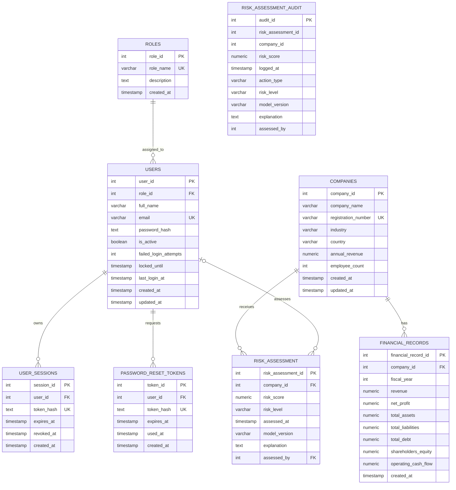
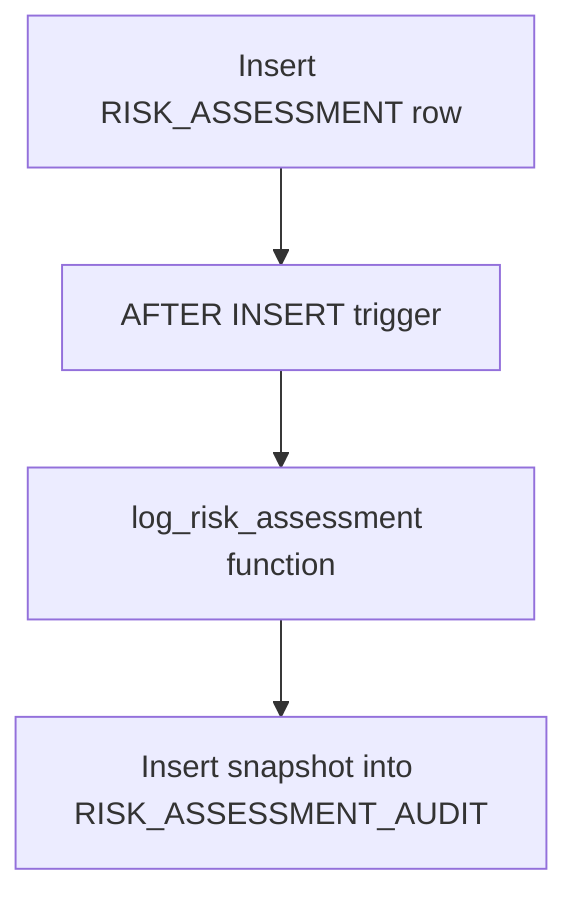

# AEGIS Entity–Relationship (ER) Design

## 1. Purpose and scope

This document presents the conceptual and logical data model for AEGIS — Financial Risk & Event Intelligence Platform. It is derived from the PostgreSQL DDL tracked at `database/ddl/01_schema.sql`.

The implemented relational model contains eight tables: `companies`, `financial_records`, `roles`, `users`, `user_sessions`, `password_reset_tokens`, `risk_assessment`, and `risk_assessment_audit`. This diagram describes the implemented database, not unimplemented future modules.

## 2. Entities

- **COMPANIES:** Organization analyzed by AEGIS. Identified by `company_id`; stores company name, registration number, industry, country, annual revenue, employee count and timestamps.
- **FINANCIAL_RECORDS:** A company's financial measurements for a fiscal year. Identified by `financial_record_id`; references `companies.company_id`. A UNIQUE constraint on `(company_id, fiscal_year)` permits at most one record per company per year.
- **ROLES:** Application role assigned to users. Identified by `role_id`; `role_name` is also NOT NULL and UNIQUE.
- **USERS:** Authenticated application account. Identified by `user_id`; references `roles.role_id`; `email` is NOT NULL and UNIQUE. Includes password hash, account status and login-security attributes.
- **USER_SESSIONS:** Session token hash and lifecycle data. Identified by `session_id`; references `users.user_id`; `token_hash` is UNIQUE.
- **PASSWORD_RESET_TOKENS:** Password-reset token hash, expiry and use timestamps. Identified by `token_id`; references `users.user_id`; `token_hash` is UNIQUE.
- **RISK_ASSESSMENT:** A company's risk evaluation at a point in time. Identified by `risk_assessment_id`; requires `company_id`; optionally references the assessing user through `assessed_by`. Score is constrained to 0–100 and level to LOW, MEDIUM, HIGH or CRITICAL. Multiple assessments preserve history.
- **RISK_ASSESSMENT_AUDIT:** Snapshot created by the AFTER INSERT trigger on `risk_assessment`. Identified by `audit_id`; stores copied source assessment/company identifiers and assessment attributes.

**Audit relationship caveat:** The current DDL does not declare foreign keys from `risk_assessment_audit` to `risk_assessment`, `companies` or `users`. The trigger copies these identifiers, so the source association is logical and trigger-generated, not enforced by a declared FK.

## 3. ER diagram

The following Mermaid ER diagram represents declared foreign-key relationships in the current DDL.

### Audit snapshot flow

This trigger flow is not a declared foreign-key relationship.

## 4. Relationships and cardinalities

| Parent | Child | Cardinality | Meaning |
|---|---|---|---|
| COMPANIES | FINANCIAL_RECORDS | 1 : 0..N | Each financial record belongs to one company; a company may have none or many. |
| COMPANIES | RISK_ASSESSMENT | 1 : 0..N | Each assessment belongs to one company; a company may have none or many. |
| ROLES | USERS | 1 : 0..N | Each user has one role; a role may be assigned to many users. |
| USERS | USER_SESSIONS | 1 : 0..N | Each session belongs to one user; a user may have many sessions. |
| USERS | PASSWORD_RESET_TOKENS | 1 : 0..N | Each reset token belongs to one user; a user may have many tokens. |
| USERS | RISK_ASSESSMENT | 1 : 0..N, optional child reference | An assessment may have no assessor; if present, it references one user. |
| RISK_ASSESSMENT | RISK_ASSESSMENT_AUDIT | Trigger-generated logical association | An insert creates an audit snapshot; no FK is declared in current DDL. |

## 5. Participation constraints and business rules

- Each financial record must reference an existing company.
- Each company may have multiple financial records, but no more than one per fiscal year.
- Each user must reference an existing role.
- Each session and reset token must reference an existing user.
- Each risk assessment must reference an existing company.
- `assessed_by` is nullable; deleting the referenced user sets it to NULL.
- Risk scores must be in the inclusive range 0–100; risk level must be one of four permitted values.
- Risk assessments are append-only under the installed BEFORE UPDATE OR DELETE trigger.
- An AFTER INSERT trigger writes an audit snapshot.

## 6. ER-to-relational mapping

- Each entity maps to an independent relation.
- One-to-many relationships are implemented by foreign keys on the many-side relation.
- The optional assessor relationship is implemented by nullable `risk_assessment.assessed_by`.
- The company/fiscal-year uniqueness rule is implemented by `UNIQUE(company_id, fiscal_year)`.
- Audit snapshots are stored separately and populated by a trigger; copied source identifiers are not currently protected by foreign keys.

## 7. Design observations

1. The current DDL does not contain relations for market events, news articles, evidence documents or vector embeddings. They must not be presented as implemented entities unless added to the database.
2. `companies.registration_number` is UNIQUE but nullable, so it is not treated as a candidate key.
3. Audit foreign keys could be considered in a future migration, but retention and delete behavior must be evaluated before changing the schema.
4. This document is derived from tracked DDL. The live database should be compared with it before final submission to identify any local-only changes.

## 8. Conclusion

The ER model separates company master data, annual financial facts, identity and access management, risk assessments and audit snapshots. Declared foreign keys implement the principal one-to-many relationships, while constraints and triggers enforce key business rules. This ER model is the foundation for the AEGIS relational schema and SQL implementation.
