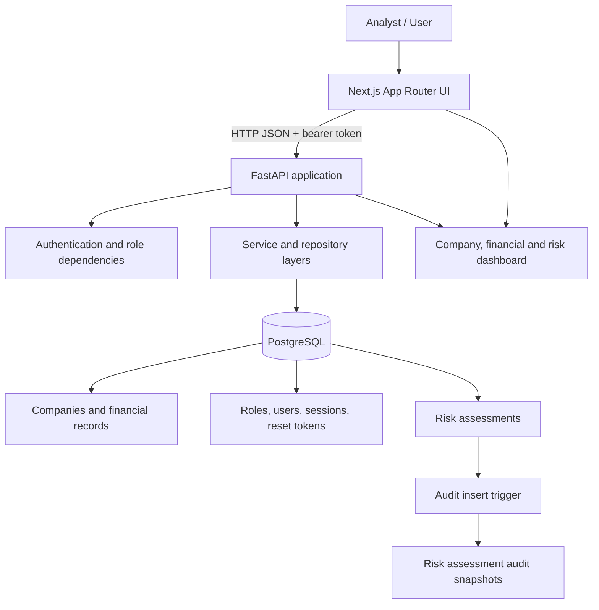
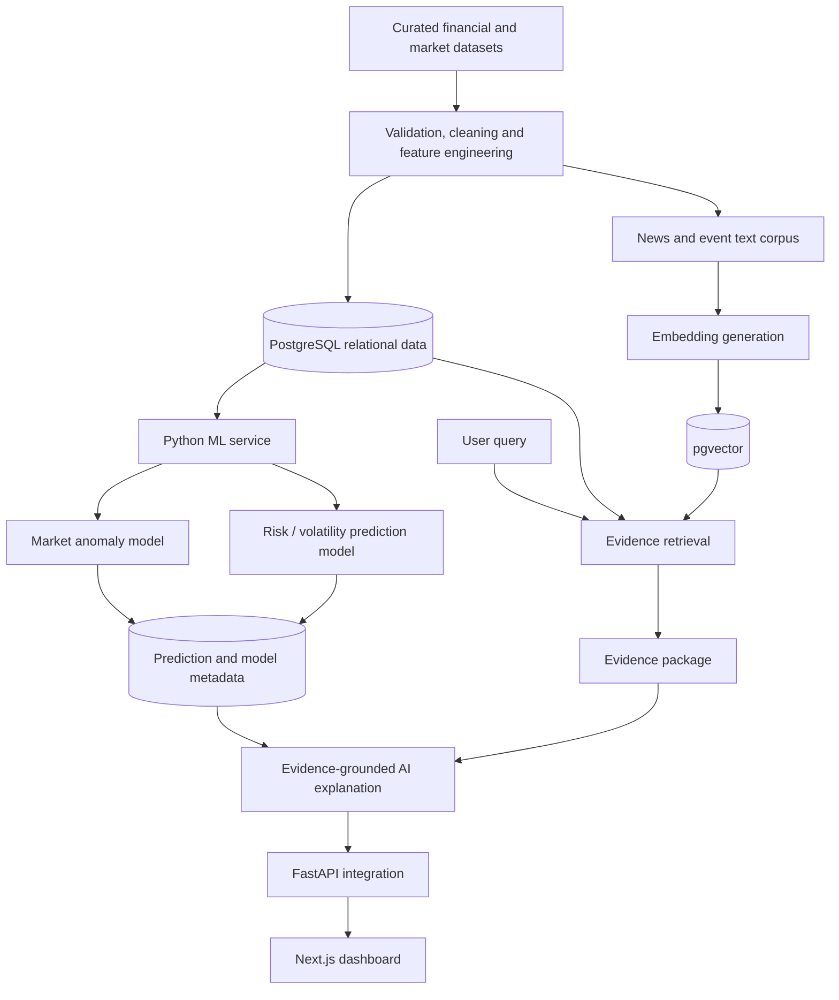

# AEGIS System Architecture

## 1. Purpose and implementation status

AEGIS is a financial risk and event-intelligence application. The current implemented application consists of a Next.js frontend, a FastAPI backend, and PostgreSQL. The database is the source of truth for company, financial, identity, risk-assessment, and audit data.

This document distinguishes implemented components from planned ML, event-ingestion, vector-retrieval, and AI capabilities. A box in the planned architecture is not evidence that the component is already operational.

## 2. Current implemented architecture

### Implemented application responsibilities

**Next.js frontend**
- Registration, login, logout and session-protected dashboard.
- Company monitoring.
- Financial-record display.
- Risk summary and assessment history.
- Database audit-history display.

**FastAPI backend**
- Versioned API mounted at `/api/v1`.
- Authentication, session and role-aware dependencies.
- Company and financial-record reads.
- Risk summary, assessment history, assessment creation and audit-history reads.
- Pydantic schemas and service/repository separation.

**PostgreSQL**
- Company and annual financial data.
- Roles, users, sessions and password-reset tokens.
- Risk assessments and append-only protection.
- Trigger-generated risk-assessment audit snapshots.
- Company risk view, database routines, constraints and indexes.

## 3. Current data flow

1. A user registers or signs in through the Next.js interface.
2. The frontend sends requests to FastAPI using the configured API base URL.
3. FastAPI validates requests and checks authentication/authorization dependencies.
4. Service and repository code accesses PostgreSQL.
5. Company, financial, risk-summary, assessment-history and audit-history data are returned to the frontend.
6. When an authorized ANALYST creates a risk assessment, the backend calls the existing database procedure; the database trigger records an audit snapshot.
7. The dashboard displays the returned records.

## 4. Planned intelligence architecture

The following diagram describes the target project scope. The ML models, event/news pipeline, full semantic retrieval flow, and evidence-grounded AI explanation are not yet complete.

Planned intelligence components must preserve provenance: dataset/source, observation time, feature definition, model version, prediction time, and evidence identifiers. Exact numeric financial facts should come from structured data or deterministic calculations; retrieved text supports contextual explanations.

## 5. Database integrity and history

The implemented schema separates company master data, financial records, identity/access data, risk assessments, and audit snapshots. Primary keys, foreign keys, uniqueness/check constraints, routines, views and triggers are defined in the database DDL.

Risk assessments are historical records. The append-only protection trigger prevents ordinary UPDATE/DELETE operations covered by that trigger. An AFTER INSERT trigger records a snapshot in `risk_assessment_audit`. The audit-history API reads those existing snapshots; it does not replace the trigger or modify the schema.

The current audit table's copied source identifiers are not foreign-key-enforced in the core DDL. Preserve that limitation in explanations and reports.

## 6. Security boundary

- Passwords are stored as hashes, not plaintext.
- Database credentials belong in environment configuration, not frontend source.
- Protected API operations use authentication dependencies; risk-assessment creation additionally requires the ANALYST role.
- The frontend currently stores the session token in browser `sessionStorage`, not an HttpOnly cookie. This is a known limitation and should not be described as production-grade session security.
- Database access remains behind the backend; browser code must not connect directly to PostgreSQL.

## 7. Verification boundary and known gaps

The repository includes backend tests and PostgreSQL CI validation. Frontend production-build verification is documented in the README. These checks do not by themselves prove every possible end-to-end workflow.

Not yet complete:
- Curated financial market observations and securities data pipeline.
- Financial event/news storage and ingestion.
- Two trained and evaluated ML models and prediction-serving integration.
- Full production pgvector embedding/retrieval workflow.
- Evidence-grounded AI explanation workflow.

Docker, cloud hosting, and production deployment are outside the agreed project scope and are not deliverables for this implementation.
