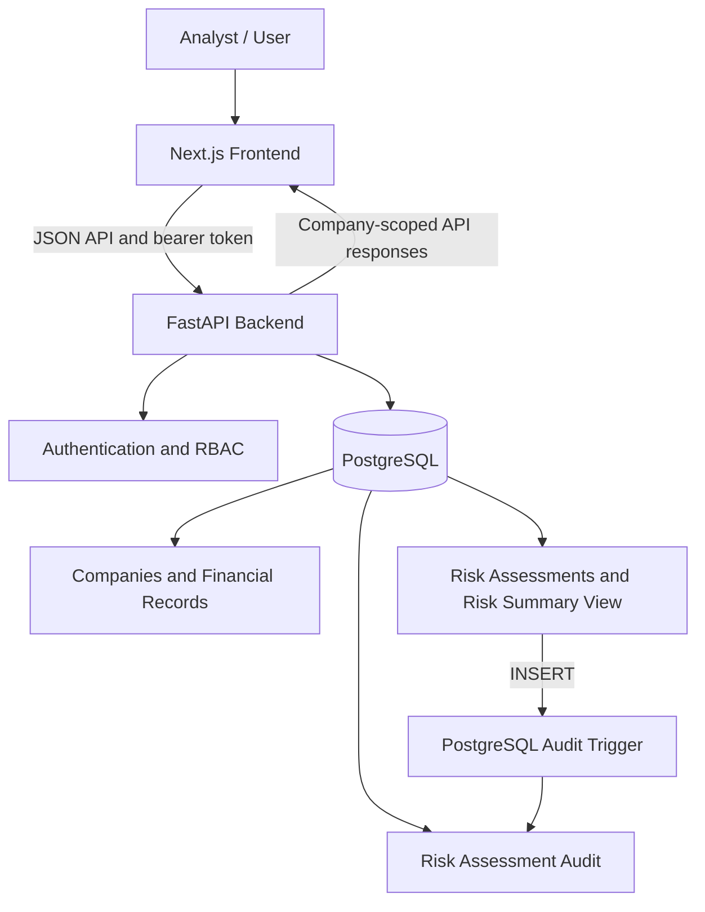

# AEGIS System Architecture

## 1. Current application architecture

The current application uses a Next.js web frontend, a FastAPI backend, and the existing PostgreSQL database:

The frontend is in `frontend/`; the backend application, API routes, schemas, services, repositories, and database session handling are in `backend/app/`. PostgreSQL objects are defined in `database/ddl/01_schema.sql`. The application reflects the existing tables rather than defining a competing schema.

## 2. Authentication and authorization flow

1. The frontend submits registration or login requests to the FastAPI authentication routes.
2. Registration creates an ANALYST account. Login verifies credentials and creates a server-managed session whose opaque bearer token is stored in hashed form in `user_sessions`.
3. The frontend retains its active bearer token in browser `sessionStorage` and includes it on authenticated API requests.
4. FastAPI resolves the token against an active, unexpired database session and derives the user and role from PostgreSQL.
5. Company, financial-record, risk-read, and audit-history routes require authentication. Risk-assessment creation additionally requires the ANALYST role; the API takes the assessor ID from the authenticated identity.

## 3. Risk-assessment and audit flow

1. An authenticated ANALYST selects a company and submits a risk assessment through the frontend.
2. FastAPI validates the request, checks that the company exists, sets the assessor to the authenticated user, and calls the existing PostgreSQL assessment procedure.
3. PostgreSQL inserts the append-only row into `risk_assessment`.
4. The existing `AFTER INSERT` trigger invokes `public.log_risk_assessment()` and copies the inserted assessment fields to `risk_assessment_audit`.
5. The frontend retrieves assessment history and risk summary through the existing API routes. It retrieves application audit history separately from `GET /api/v1/companies/{company_id}/audit-history`, which reads the persisted audit rows for that company.

Financial records are read from the existing PostgreSQL table through the company-scoped financial-record route. Company monitoring uses the authenticated company list/detail routes.

## 4. Implemented and unimplemented boundaries

### Implemented

- Next.js frontend and FastAPI backend integration
- PostgreSQL-backed authentication, sessions, and role-based access control
- Company monitoring and financial-record reads
- Risk assessment creation, history, and summary
- Trigger-generated PostgreSQL audit snapshots and authenticated application-level audit-history reads

### Not implemented

- Trained ML model or model inference/service integration
- Live news or financial-event ingestion
- Production pgvector deployment, embeddings, or RAG
- Cloud hosting, containerization, or production deployment infrastructure

The optional SQL in `database/vector/01_pgvector_evidence.sql` is not an implemented application retrieval service. The proposed capabilities above must not be interpreted as current runtime components.

## 5. Database integrity and verification

The PostgreSQL schema defines company and financial data, user and role data, sessions and reset tokens, risk assessments, and audit snapshots. Database constraints and triggers enforce the rules represented in the tracked DDL. Risk assessments are append-only, and the audit table is populated by the database trigger rather than by a separate application-generated history.

Backend API tests use a separate disposable PostgreSQL test database. Database verification scripts and the PostgreSQL validation workflow cover schema and database behavior independently of application-level API verification.
