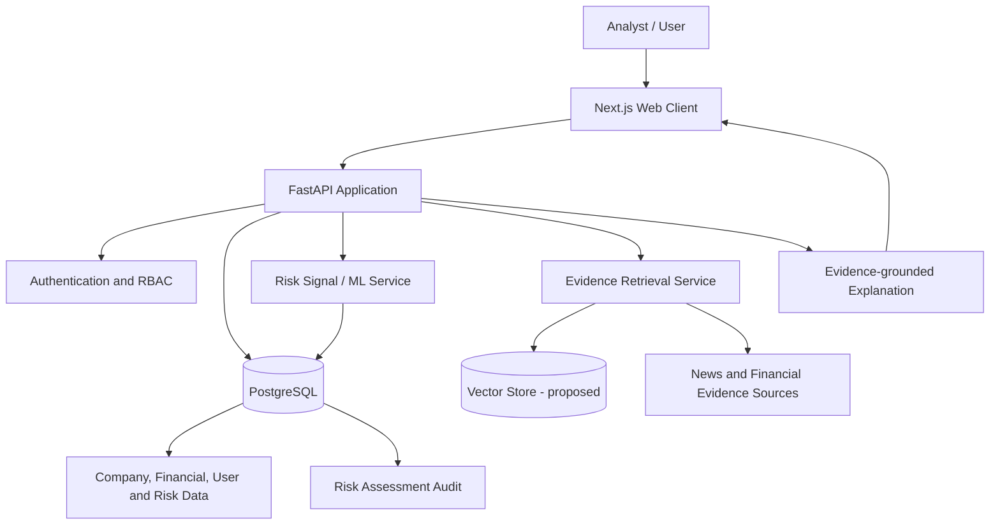

# AEGIS System Architecture

## 1. Purpose

This document distinguishes the database components currently present in the repository from the application and intelligence layers proposed by the project requirements.

## 2. Current implementation boundary

The tracked implementation includes a PostgreSQL schema and SQL portfolio.

### Implemented database components

- Company master data: `companies`
- Annual financial data: `financial_records`
- Access-control data: `roles` and `users`
- Session and password-reset data: `user_sessions` and `password_reset_tokens`
- Historical risk results: `risk_assessment`
- Insert audit snapshots: `risk_assessment_audit`
- SQL routines, a company risk view, and integrity triggers as defined in `database/ddl/01_schema.sql`

### Not present in the tracked source tree at this stage

- FastAPI backend source
- Next.js frontend source
- pgvector extension and vector table/index definitions
- News/event ingestion pipeline
- Trained ML model and model-serving code
- Container/deployment configuration

These are proposed project layers, not verified completed components.

## 3. Proposed logical architecture

The diagram represents the intended integration boundary. Only the PostgreSQL relational objects listed in Section 2 are currently represented by tracked implementation files.

## 4. Data flow (proposed)

1. An authorized user selects a company.
2. The API reads company and financial records from PostgreSQL.
3. A risk-analysis component computes or retrieves a risk signal.
4. The API stores a new risk assessment; historical rows are preserved.
5. The database trigger writes an audit snapshot.
6. An evidence-retrieval component may retrieve supporting documents when that component is implemented.
7. The application presents the result and supporting evidence to the user.

## 5. Database integrity and history

The schema separates master data, annual financial records, user identity, access roles, sessions, reset tokens, risk assessments, and audit snapshots. Foreign keys and check/unique constraints enforce the rules explicitly defined in the DDL.

Risk assessments are append-only through the included modification-prevention trigger. A new assessment should be inserted when a new result is produced rather than overwriting a historical result.

The audit table receives an INSERT snapshot through a trigger. Its copied identifiers are not foreign-key-enforced in the current DDL.

## 6. Security considerations

- Store password hashes, never plaintext passwords.
- Keep database credentials outside source control.
- Use least-privilege database roles.
- Validate and authorize every API operation.
- Hash session/reset tokens before storage.
- Enforce expiry and revocation checks in the application.
- Avoid exposing internal error details or secrets to clients.

These are design requirements; application-level enforcement must be verified in backend code before it can be claimed as implemented.

## 7. Verification status

The architecture description is based on the tracked schema and project requirements. Live service connectivity, UI behavior, model execution, vector retrieval, and end-to-end workflows require runtime verification.
