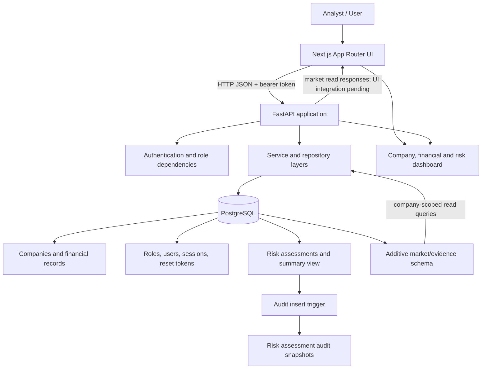
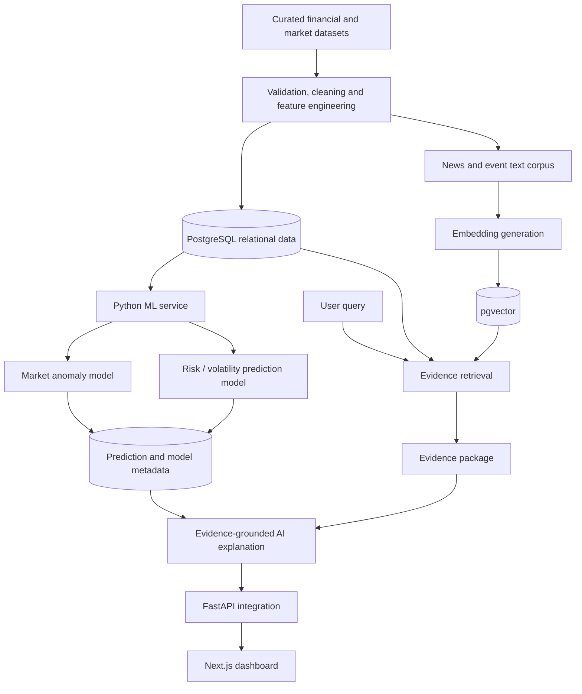

# AEGIS System Architecture

## 1. Purpose and implementation status

The current application consists of a Next.js frontend, a FastAPI backend, and PostgreSQL. PostgreSQL is the source of truth for the company, financial, identity, risk-assessment, and audit data used by the implemented application.

This document separates implemented components from planned intelligence capabilities. Components shown in the planned architecture are not claims of current operation.

## 2. Current implemented architecture

The frontend is in `frontend/`; the backend routes, schemas, services, repositories, and database session handling are in `backend/app/`. The core database DDL is `database/ddl/01_schema.sql`; market/evidence objects are a separate additive migration at `database/ddl/02_market_evidence.sql`. The application accesses PostgreSQL through the backend and does not define a competing schema.

### Implemented application responsibilities

**Next.js frontend**
- Registration, login, logout, and a session-protected dashboard.
- Company monitoring and financial-record display.
- Risk summary and assessment history.
- Database audit-history display for the selected company.

**FastAPI backend**
- Versioned API mounted at `/api/v1`.
- Authentication, server-managed sessions, and role-aware dependencies.
- Company and financial-record reads.
- Risk summary, assessment history, assessment creation, and audit-history reads.
- Read-only security, market-observation, financial-event, and news-article APIs, scoped to the requested company.
- Pydantic schemas and service/repository separation.

**PostgreSQL**
- Company and annual financial data; roles, users, sessions, and reset tokens.
- Risk assessments, append-only protection, and trigger-generated audit snapshots.
- Company risk view, routines, constraints, and indexes.
- The separate market/evidence migration adds securities, market observations, events, news articles, and model-prediction storage. Its presence does not imply live news ingestion or ML inference.

The market/evidence tables are exposed through authenticated, company-scoped FastAPI read routes. The Next.js dashboard has not yet been integrated with these market APIs; market/evidence UI work is a separate application step.

## 3. Authentication and authorization flow

1. A user registers or signs in through the Next.js interface.
2. FastAPI validates credentials and creates a server-managed session; the database stores the bearer token hash in `user_sessions`.
3. The frontend retains its session token in browser `sessionStorage` and sends it with protected API requests.
4. FastAPI resolves the session and derives the user identity and role from PostgreSQL.
5. Company, financial-record, risk-read, and audit-history routes require authentication. Risk-assessment creation additionally requires the ANALYST role; the authenticated identity supplies `assessed_by`.

The current browser session storage is not an HttpOnly-cookie design and is a known security limitation. Database credentials remain server-side; browser code does not connect directly to PostgreSQL.

## 4. Risk-assessment and audit flow

1. An authenticated ANALYST selects a company and submits an assessment through the frontend.
2. FastAPI validates the request, verifies the company, sets the assessor to the authenticated user, and calls the existing PostgreSQL procedure.
3. PostgreSQL inserts an append-only row into `risk_assessment`.
4. The existing `AFTER INSERT` trigger invokes `public.log_risk_assessment()` and copies the assessment fields into `risk_assessment_audit`.
5. The dashboard retrieves risk summary/history and audit snapshots through company-scoped API routes. Both `GET /api/v1/companies/{company_id}/audit-history` and the paginated `GET /api/v1/companies/{company_id}/risk-audit-history` read those persisted snapshots.

The audit API does not replace the trigger or modify the schema. In the core DDL, copied audit identifiers are not declared as foreign keys.

## 5. Planned intelligence architecture

The following target architecture is not fully implemented: trained models, automated event/news ingestion, complete semantic retrieval, and evidence-grounded AI explanations remain future work.

The repository includes a historical market-data adapter, but that is not automated live news/event ingestion or an ML prediction service. Docker, cloud hosting, and production deployment are outside the agreed project scope.

## 6. Database integrity and verification

The PostgreSQL DDL defines constraints, routines, views, and triggers for the tracked schema. Risk assessments are historical records; the append-only trigger prevents the covered UPDATE/DELETE operations, and an `AFTER INSERT` trigger writes the audit snapshot.

Backend API tests use a separate disposable PostgreSQL database. PostgreSQL CI validation checks database behavior; frontend production-build verification is documented in the README. These checks do not by themselves prove every possible end-to-end workflow.
